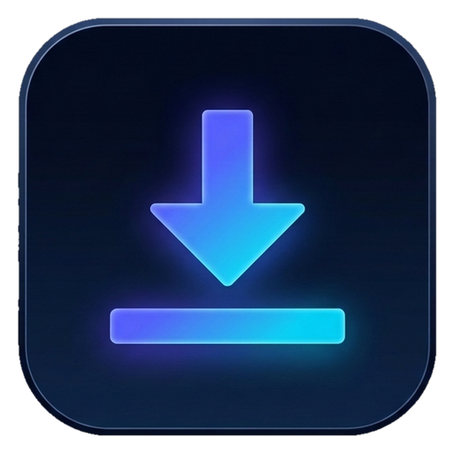

<p align="center">
  
</p>

<h1 align="center">Media Downloader Studio</h1>

<p align="center">
  YouTube・X (旧Twitter)・TikTok・ニコニコ動画・SoundCloud などから<br />
  高画質動画＆高音質音声（MP3 / M4A / WAV / FLAC 等）を簡単に保存できる Windows デスクトップアプリ
</p>

<p align="center">
  <a href="https://github.com/koutyann115/media-downloader-studio/releases/latest">
    <strong>📦 最新版 Windows EXE をダウンロード (Releases)</strong>
  </a>
</p>

---

## 主な機能

- **単体 EXE・FFmpeg 内蔵で即起動**
  - Python や FFmpeg の事前インストール不要。`MediaDownloaderStudio.exe` をダブルクリックするだけで専用ウィンドウが立ち上がり、右上の「×」ボタンでバックグラウンド処理も含めて完全に終了します。
- **URL 貼り付けで自動プレビュー＆対応画質を検出**
  - URL を入力するとタイトル・サムネイル・再生時間・選択可能な解像度（4K / 2K / 1080p / 720p など）を自動取得します。
- **自由な形式・画質・音質設定**
  - **動画**: `MP4` / `WEBM` / `MKV`（最高画質 4K〜360p まで選択可能、高画質映像＋音声の自動結合に対応）
  - **音声抽出**: `MP3` / `M4A` / `WAV` / `FLAC` / `OPUS`（320kbps〜128kbps、無劣化ロスレス対応）
- **リアルタイム進捗表示＆キュー管理**
  - 進捗バー、ダウンロード容量、転送速度、残り時間（ETA）をリアルタイム表示。
  - 複数 URL の一括入力に対応（同時最大 2 件ずつの順番待ちキュー制御・即時キャンセル対応）。
- **時間指定カット（切り抜き保存）＆詳細オプション**
  - 開始時間〜終了時間（例: `01:20` 〜 `03:45`）を指定した FFmpeg 高速切り抜き保存に対応。
  - カスタムファイル名指定、サムネイル埋め込み、字幕埋め込みに対応。
- **保存先フォルダの永続化＆ワンクリックで開く**
  - 選んだ保存先フォルダは次回起動時も引き継がれます。
  - 「📁 保存先を開く」ボタンで、保存したファイルが選択された状態でエクスプローラーを開けます。

---

## 使い方（EXE 版 — おすすめ）

1. [Releases](https://github.com/koutyann115/media-downloader-studio/releases/latest) から `MediaDownloaderStudio.exe` をダウンロードします。
2. `MediaDownloaderStudio.exe` をダブルクリックして起動します。
3. 保存したい動画・音声の URL を貼り付け、形式・画質・保存先を選んで **「ダウンロード開始」** をクリックします。

> **Note:** Windows Defender SmartScreen の警告が表示された場合は、「詳細情報」→「実行」で起動できます（個人開発の未署名バイナリのため表示されます）。

---

## ソースコードから実行 / EXE ビルドする方法

Python 3.10 以上が必要です。

```bash
git clone https://github.com/koutyann115/media-downloader-studio.git
cd media-downloader-studio
pip install -r requirements.txt
```

### そのまま実行
```bash
python app.py
```

### 単体 EXE をビルド（FFmpeg 同梱）
```bash
python build_exe.py
```
ビルドが完了すると、プロジェクト直下に `MediaDownloaderStudio.exe` が生成されます。

---

## 技術スタック

- **Backend**: Python / FastAPI / Uvicorn / `yt-dlp` / `imageio-ffmpeg`
- **Desktop Wrapper**: `pywebview` (Windows WebView2)
- **Frontend**: HTML / CSS / Vanilla JavaScript
- **Packaging**: PyInstaller (`--onefile --windowed`)

---

## 免責事項・ご利用上の注意

本ツールは、著作権者から許諾を得たコンテンツ・ご自身が投稿した動画のバックアップ・クリエイティブコモンズ素材など、**著作権法および各サービスの利用規約の範囲内**でご使用ください。DRM（技術的保護手段）の回避機能は備えていません。本ツールの使用により生じたいかなるトラブル・損害についても、作者は一切の責任を負いません。

## サードパーティライセンス

本ソフトウェアおよび配布バイナリ（Releases）は以下のオープンソースソフトウェアを利用・同梱しています：

- **[yt-dlp](https://github.com/yt-dlp/yt-dlp)** — The Unlicense
- **[FFmpeg](https://ffmpeg.org/)** (via [imageio-ffmpeg](https://github.com/imageio/imageio-ffmpeg)) — LGPL / GPL（ソースコードは [ffmpeg.org](https://ffmpeg.org/download.html) より入手可能です）
- **[FastAPI](https://github.com/fastapi/fastapi)** / **[Uvicorn](https://github.com/encode/uvicorn)** — MIT / BSD License
- **[pywebview](https://github.com/r0x0r/pywebview)** — BSD-3-Clause License

## License

本プロジェクト独自のソースコードは [MIT License](LICENSE) のもとで公開されています。
